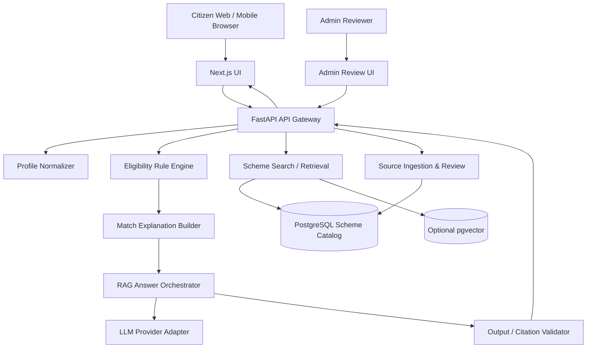

# SchemeSathi AI — Technical Architecture
**Architecture:** Modular full-stack web application with retrieval-grounded AI and deterministic eligibility rules.

## 1. Recommended stack
- Frontend: Next.js (App Router), TypeScript, Tailwind CSS, Framer Motion, accessible component primitives (customized).
- Backend API: FastAPI (Python 3.11+), Pydantic.
- Database: PostgreSQL.
- Search: PostgreSQL full-text search initially; pgvector optional for semantic retrieval.
- AI: provider abstraction for an LLM; use retrieval-augmented generation (RAG), not free-form scheme recall.
- Data ingestion: controlled import / admin entry of official sources; scheduled refresh can be added after MVP.
- Auth: optional for MVP; admin auth required for content operations.
- Deployment: frontend on Vercel or equivalent; API and PostgreSQL on a secure managed platform.
- Observability: structured logs, request IDs, error tracking; redact profile attributes.

## 2. High-level flow
1. User enters optional profile information in guided flow.
2. Frontend submits profile to API.
3. Eligibility service evaluates structured rules against normalized profile.
4. Search service retrieves relevant approved scheme records and source passages.
5. AI explanation service receives only relevant scheme records, criterion outcomes, and source excerpts.
6. Response validator checks schema, citations, and prohibited unsupported claims.
7. API returns scheme match cards with criteria details, sources, freshness, and disclaimer.
8. User can open detail, ask follow-up, save locally, or navigate to official portal.

## 3. Mermaid system diagram


## 4. Domain model
### Scheme
- `id` UUID
- `slug`, `name`, `short_description`, `benefit_summary`
- `level` enum: central/state
- `state_code`, `district_scope` nullable
- `category`, `target_groups[]`
- `benefit_type`, `benefit_amount_text` (source-derived, never generated)
- `application_steps[]`, `documents[]`
- `official_application_url`, `official_source_url`
- `source_org`, `source_domain`
- `source_excerpt`, `source_retrieved_at`, `verified_at`
- `status` enum: draft/reviewed/published/needs_verification/archived
- `freshness_policy_days`, `created_at`, `updated_at`

### EligibilityRule
- `id`, `scheme_id`, `field_key`
- `operator` (eq, in, gte, lte, between, contains, boolean)
- `value_json`, `required` boolean
- `source_reference`, `rule_notes`
- `unknown_behavior` enum: mark_unknown / exclude_from_match

### UserProfile (prefer ephemeral)
- normalized fields and consent metadata.
- Store only if user opts in; otherwise process transiently.
- Avoid exact DOB, Aadhaar, bank data, OTP, credentials.

### SourceRecord
- `id`, `scheme_id`, `url`, `organization`, `domain`
- `excerpt`, `retrieved_at`, `verified_at`, `reviewer_id`
- `review_status`, `content_hash`, `notes`

### Feedback
- `id`, `scheme_id`, `rating`, `comment`, `created_at`
- Profile data excluded.

## 5. API endpoints
- `GET /api/v1/schemes` — search and filter published catalog.
- `GET /api/v1/schemes/{scheme_id}` — scheme detail and citations.
- `POST /api/v1/eligibility/matches` — profile -> deterministic criterion results + potential matches.
- `POST /api/v1/assistant/chat` — grounded follow-up response.
- `POST /api/v1/feedback` — helpfulness / outdated report.
- `GET /api/v1/categories` — available categories and filters.
- Admin:
  - `POST /api/v1/admin/schemes`
  - `PATCH /api/v1/admin/schemes/{id}`
  - `POST /api/v1/admin/schemes/{id}/review`
  - `POST /api/v1/admin/schemes/{id}/publish`
  - `GET /api/v1/admin/source-records`

Use versioned API, pagination, validation, rate limits, and consistent error envelopes.

## 6. RAG design
- Retrieval only over approved, published or reviewed source content.
- Hybrid retrieval: keyword + optional vector similarity.
- Filter by state, scheme status, language, and source review state.
- Prompt receives source IDs and exact excerpts.
- Each generated factual claim must map to a citation ID.
- No source -> answer “I could not verify this from an official source.”
- Validator rejects unknown citation IDs, missing citations for benefit/deadline/eligibility claims, unsupported amounts, and generated URLs.
- Provide source snippet and official link for user inspection.
- LLM is an explanation layer; eligibility rule engine is source of truth.

## 7. Eligibility matching algorithm
For each published scheme:
1. Load rule definitions and scope constraints.
2. Compare each rule with normalized profile.
3. Emit criterion outcome: `matched`, `not_met`, or `unknown`.
4. Hard exclusion rule not met => mark `does_not_match`.
5. Missing required data => `needs_more_information`.
6. Otherwise potential match, with explanation generated from outcomes.
7. Rank by rule completeness, geography fit, source freshness, and category relevance—not by fabricated confidence.
8. Return reasons and caveats, not a guarantee.

## 8. Security and privacy
- TLS in transit; encrypted database and secrets management.
- Admin role-based access control, audit logs.
- Input validation, output encoding, CSRF protection where applicable, rate limits.
- Prompt-injection defenses: source documents are data, not instructions.
- PII minimization; do not collect Aadhaar/OTP/bank credentials.
- Redact profile values from logs and telemetry.
- Set retention and deletion controls; profile reset supported.
- External official URLs are allowlisted/validated; warn before leaving site.
- No training of models on user profiles unless explicit separate consent.

## 9. Reliability and quality
- Use typed schemas for model output.
- Add deterministic fallback if AI provider fails: show rules and source summaries.
- Cache public scheme catalog and source records; do not cache personal profile responses across users.
- Unit tests for rules; integration tests for retrieval and citation validation.
- Content freshness monitor and review queue.
- Seed data in dev must be labeled clearly as demo and never impersonate a verified official source.

## 10. Repository structure
```text
schemesathi-ai/
├── apps/
│   └── web/                 # Next.js, TypeScript, Tailwind, motion
├── services/
│   └── api/                 # FastAPI
├── packages/
│   └── shared/              # types, constants, API contracts
├── data/
│   ├── seed_demo/            # explicitly labeled demo records
│   └── source_manifest/
├── docs/
│   ├── PRD.md
│   ├── design.md
│   ├── architecture.md
│   └── agents.md
├── tests/
├── docker-compose.yml
├── .env.example
└── README.md
```

## 11. Environment variables
- `DATABASE_URL`
- `LLM_PROVIDER`
- `LLM_API_KEY`
- `LLM_MODEL`
- `NEXT_PUBLIC_API_BASE_URL`
- `ADMIN_SECRET` / auth provider settings
- `LOG_LEVEL`
Never commit real secrets. `.env.example` contains placeholders only.
